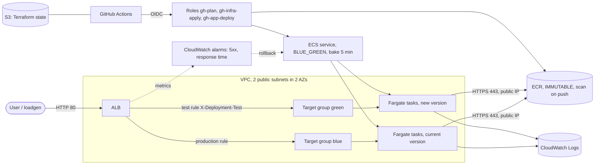
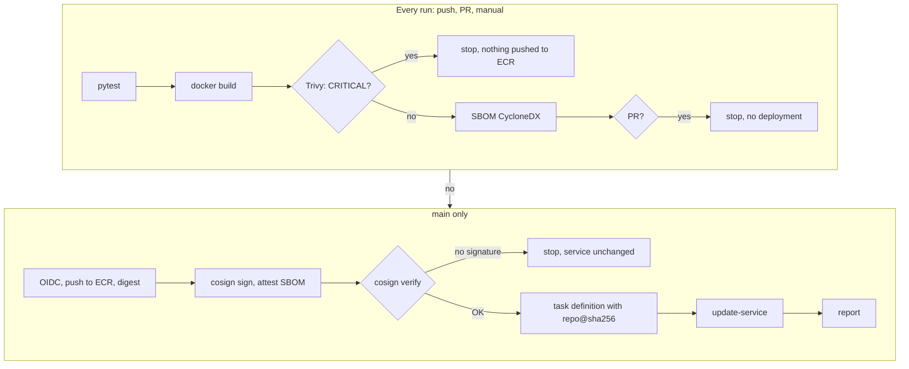
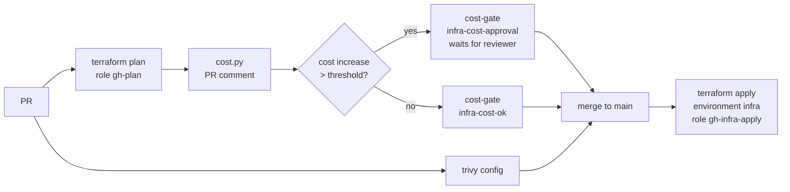
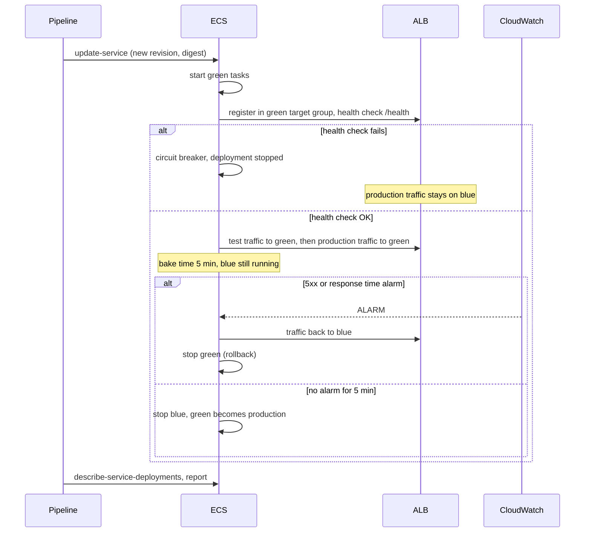

# Architecture

## AWS infrastructure

Resources:

- `network.tf`: VPC, 2 public subnets, Internet Gateway, no NAT Gateway,
- `ecr.tf`: repository with immutable tags, scan on push, KMS encryption, lifecycle (20 images),
- `alb.tf`: ALB, HTTP 80 listener, blue and green target groups with a `/health` health check, production and test rules,
- `ecs.tf`: cluster with Container Insights, task definition (read-only root filesystem), service with the `BLUE_GREEN` strategy,
- `monitoring.tf`: ALB-level alarms (`LoadBalancer` dimension, covers both target groups),
- `iam.tf`: GitHub Actions roles, task execution role, ECS infrastructure role for blue/green.

## Application pipeline (`app.yml`)

Signature verification and deployment live in `scripts/deploy.sh`. The same script is called by `scripts/demo-unsigned.sh`, so the unsigned image demo uses exactly the same path as the pipeline.

## Infrastructure pipeline (`infra.yml`)

## Blue/green deployment with bake time

