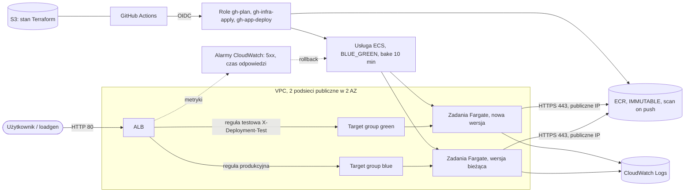
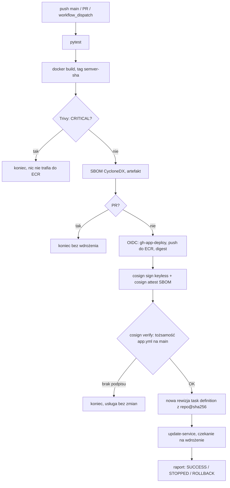
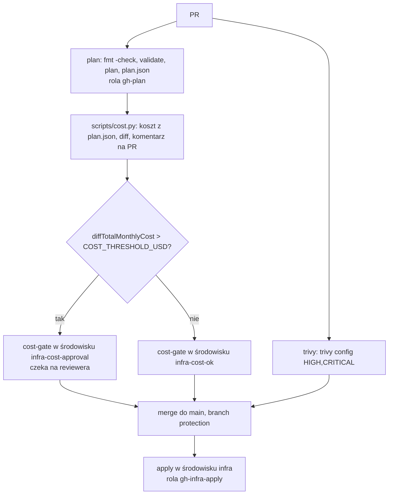
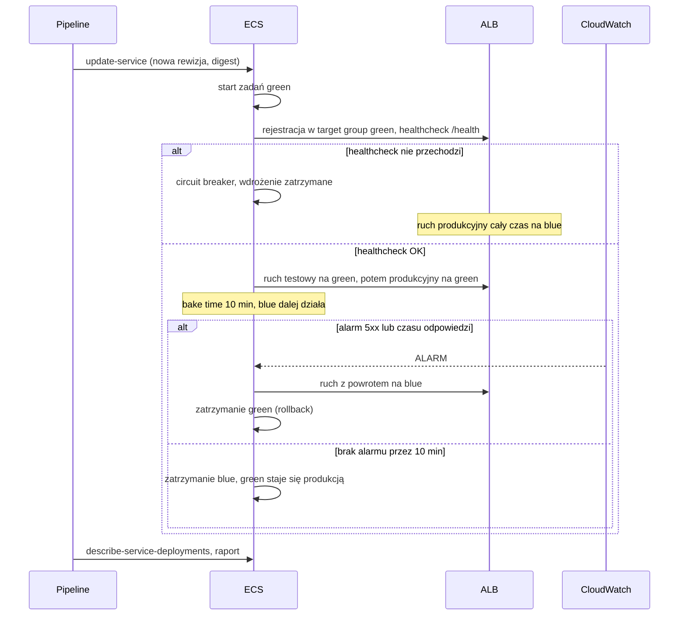

# Architektura

## Infrastruktura AWS

Zasoby:

- `network.tf`: VPC, 2 podsieci publiczne, Internet Gateway, bez NAT Gateway,
- `ecr.tf`: repozytorium z niezmiennymi tagami, skanem przy push, szyfrowaniem KMS, lifecycle (20 obrazów),
- `alb.tf`: ALB, listener HTTP 80, target groupy blue i green z healthcheckiem `/health`, reguła produkcyjna i testowa,
- `ecs.tf`: klaster z Container Insights, task definition (read-only root filesystem), usługa w strategii `BLUE_GREEN`,
- `monitoring.tf`: alarmy na poziomie ALB (wymiar `LoadBalancer`, obejmuje oba target groupy),
- `iam.tf`: role dla GitHub Actions, rola wykonawcza zadań, rola infrastrukturalna ECS dla blue/green.

## Pipeline aplikacji (`app.yml`)

Weryfikacja podpisu i wdrożenie są w `scripts/deploy.sh`. Ten sam skrypt wywołuje `scripts/demo-unsigned.sh`, więc demonstracja odrzucenia niepodpisanego obrazu używa dokładnie tej samej ścieżki co pipeline.

## Pipeline infrastruktury (`infra.yml`)

## Wdrożenie blue/green z bake time

## Kompromisy

- **Podsieci publiczne zamiast prywatnych z NAT.** NAT Gateway kosztuje około 35-40 USD miesięcznie, a VPC endpointy interfejsowe (ECR API, ECR DKR, Logs) podobnie. Zadania mają publiczne IP, ale ich security group przyjmuje ruch tylko z security group ALB, a ruch wychodzący jest ograniczony do portu 443. Wyjątki Trivy dla tej decyzji są w `.trivyignore.yaml` z uzasadnieniem i ograniczone do konkretnych plików.
- **HTTP zamiast HTTPS.** Środowisko demo nie ma domeny ani certyfikatu. Listener HTTPS wymaga tylko certyfikatu ACM i zmiany listenera.
- **Próg kosztowy 10 USD miesięcznie.** Wycena jest liczona z planu Terraform własnym skryptem (`scripts/cost.py`) ze stałymi cenami z AWS Price List API. Nie wymaga konta w zewnętrznej usłudze, więc działa bez ograniczeń czasowych (darmowy klucz Infracost wygasa po 14 dniach). Ceny trzeba okresowo odświeżać, a koszty zależne od użycia (transfer, LCU) są pominięte. Próg jest w zmiennej repozytorium `COST_THRESHOLD_USD`.
- **Cosign keyless.** Brak kluczy do przechowywania i rotacji: tożsamością podpisującego jest workflow `app.yml` na `main` (certyfikat Fulcio, wpis w Rekor). Weryfikacja sprawdza dokładnie tę tożsamość i issuer OIDC GitHuba, więc obraz podpisany z innej gałęzi albo innego workflow zostanie odrzucony.
- **Brak natywnej weryfikacji podpisów w ECS.** Weryfikacja jest w pipeline przed `update-service`. Rola `gh-app-deploy` ma tylko uprawnienia do jednego repozytorium ECR i jednej usługi ECS.
- **Podział odpowiedzialności.** Terraform zarządza infrastrukturą i rewizją zastępczą task definition. Obraz ustawia pipeline aplikacji, dlatego usługa ma `ignore_changes` na `task_definition`, `desired_count` i `load_balancer` (ECS zamienia target groupy blue i green po każdym wdrożeniu).
- **Środowiska GitHub.** `infra` jest ograniczone do `main` i tylko z niego można przyjąć rolę `gh-infra-apply`. `cost-gate` działa na PR, więc korzysta z osobnych środowisk (`infra-cost-approval`, `infra-cost-ok`), które nie dają dostępu do AWS.
- **ECS Express Mode nie został użyty.** `aws_ecs_express_gateway_service` sam tworzy ALB z HTTPS, target groupy i autoskalowanie, ale wdraża stałą strategią canary (5% ruchu, bake 3 min, własny alarm na odsetek błędów). Nie pozwala ustawić `BLUE_GREEN`, bake time 10 minut ani własnych alarmów, a obraz jest atrybutem zasobu, a nie rewizji task definition rejestrowanej przez pipeline.
