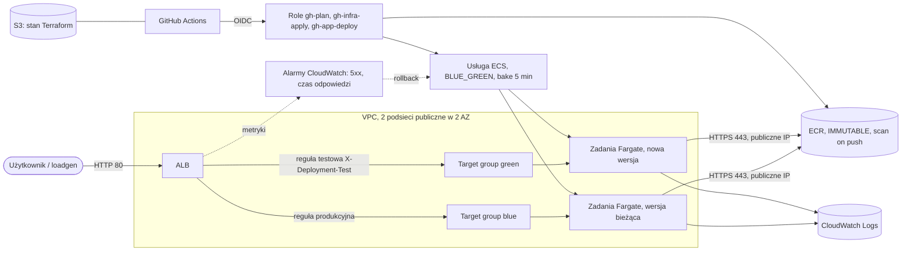
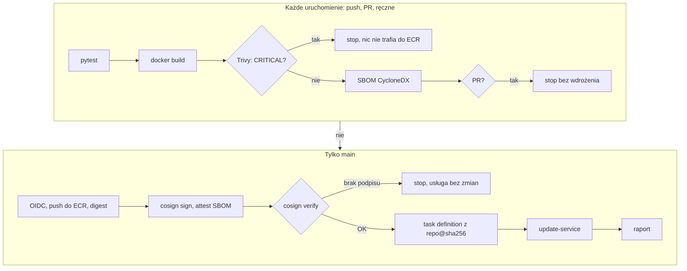
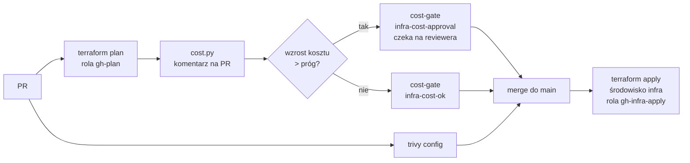
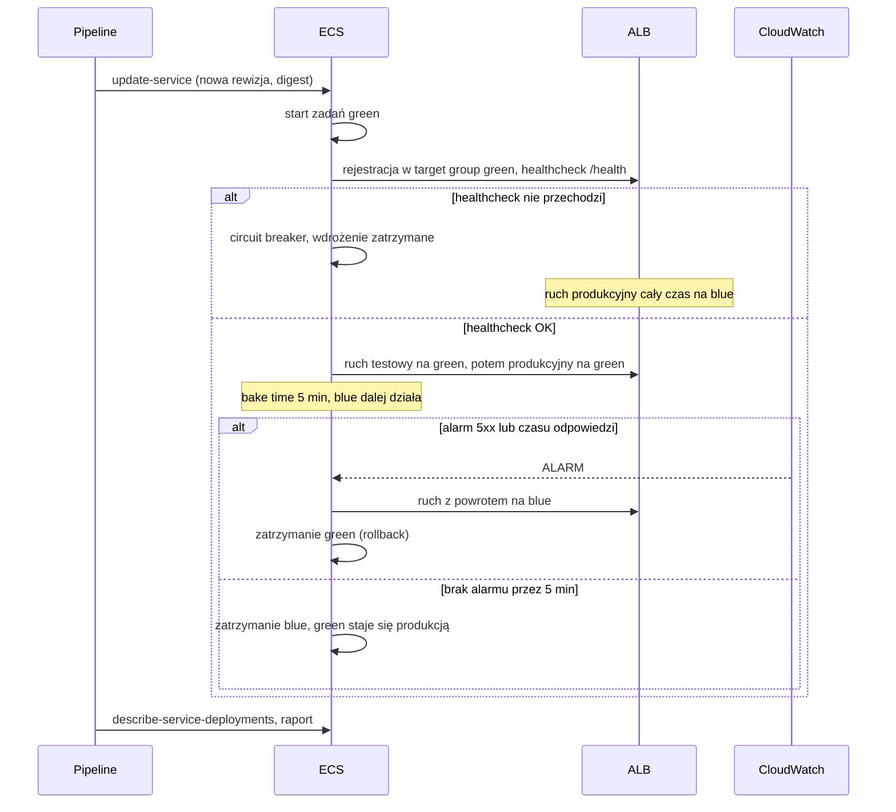

# Architektura

## Infrastruktura AWS

Zasoby:

- `network.tf`: VPC, 2 podsieci publiczne, Internet Gateway, bez NAT Gateway,
- `ecr.tf`: repozytorium z niezmiennymi tagami, skanem przy push, szyfrowaniem KMS, lifecycle (20 obrazów),
- `alb.tf`: ALB, listener HTTP 80, target groupy blue i green z healthcheckiem `/health`, reguła produkcyjna i testowa,
- `ecs.tf`: klaster z Container Insights, task definition (read-only root filesystem), usługa w strategii `BLUE_GREEN`,
- `monitoring.tf`: alarmy na poziomie ALB (wymiar `LoadBalancer`, obejmuje oba target groupy),
- `iam.tf`: role dla GitHub Actions, rola wykonawcza zadań, rola infrastrukturalna ECS dla blue/green.

## Pipeline aplikacji (`app.yml`)

Weryfikacja podpisu i wdrożenie są w `scripts/deploy.sh`. Ten sam skrypt jest wywoływany przez `scripts/demo-unsigned.sh`, więc demonstracja odrzucenia niepodpisanego obrazu używa dokładnie tej samej ścieżki co pipeline.

## Pipeline infrastruktury (`infra.yml`)

## Wdrożenie blue/green z bake time

